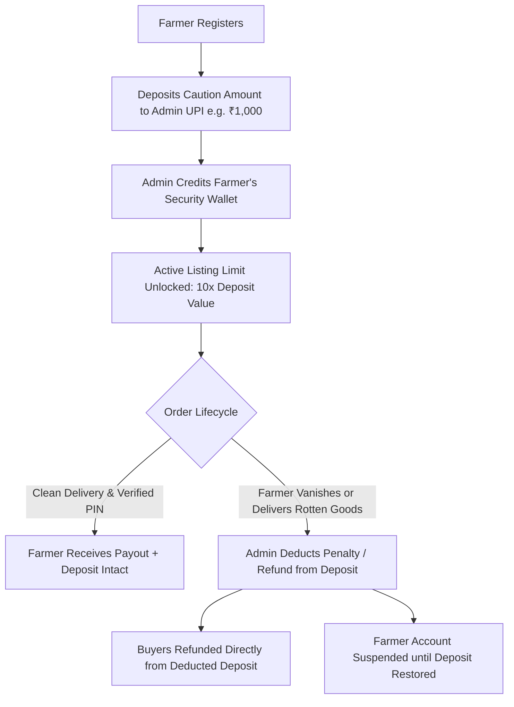

# FarmConnect - Production System Specification & Requirements

---

## 1. Executive Summary & Core Platform Vision

**FarmConnect** is an indigenous, decentralized, mobile-first Farm-to-Consumer (F2C) group-buying platform. It connects verified agricultural producers directly with residential clusters, apartment complexes, and neighborhood communities by pooling individual demand into bulk **"Buckets"** delivered to a single community drop point.

---

## 2. Updated Business Model & Financial Architecture

### 2.1. 50-50 Split Payment Structure
To guarantee serious commitment from buyers and protect farmers from dead inventory:
1. **50% Advance Commitment:**
   - When a bucket meets its threshold or is accepted by the farmer, consumers pay **50% of their total bill** upfront before harvesting/dispatch begins.
   - Total Bill Formula:
     $$\text{Total Bill} = \text{Produce Subtotal} + \text{Proportional Transport Share} + \text{Platform Fee}$$
     $$\text{Advance Due (50\%)} = \frac{\text{Total Bill}}{2}$$
     $$\text{Remaining Due at Pickup (50\%)} = \frac{\text{Total Bill}}{2}$$
2. **50% Cash on Handover (COD):**
   - The remaining 50% is paid in physical cash to the farmer / driver at the delivery drop point before taking possession of the produce.

### 2.2. Zero-Cost 50% Advance Collection (Free Direct UPI)
* **0% Transaction Commission Protocol:**
  - Advance payment operates via dynamic **Direct UPI QR Codes / UPI Deep-Links** (`upi://pay?pa=...&pn=...&am=...`).
  - Consumers scan via any standard UPI app (GPay, PhonePe, Paytm, BHIM) with **0% MDR / zero payment gateway fees**.
  - Consumers input their 12-digit UPI Reference / UTR Number.
  - The payment lands safely in the **Platform Admin Escrow UPI**, not directly into the farmer's personal account, guaranteeing refund protection.

---

## 3. Fraud Shield: Farmer Security Deposit System

To prevent fraudulent listings, bait-and-switch quality scams, or ghost farmers who take advance payments and fail to deliver:



### 3.1. Skin in the Game: The 10x Exposure Multiplier
To prevent a farmer who deposited ₹1,000 from listing ₹1,00,000 worth of produce:
$$\text{Max Allowed Active Bucket Value} = 10 \times \text{Farmer Security Deposit}$$
* **Tier 1 (₹1,000 Deposit):** Up to ₹10,000 active bucket volume.
* **Tier 2 (₹3,000 Deposit):** Up to ₹30,000 active bucket volume.
* **Tier 3 (₹5,000+ Deposit):** Uncapped bulk producer status.

### 3.2. Rolling Hold Option for Small Genuine Farmers
To prevent high onboarding friction for small rural farmers:
* **Option A (Instant):** Pay ₹1,000 deposit upfront via UPI.
* **Option B (Rolling Hold):** Farmer begins with a small trial bucket; platform withholds 15% from their first 2 delivery payouts until their Security Deposit Wallet reaches ₹1,000.

### 3.3. Deposit Penalties & Buyer Compensation
* **Unnotified Dispatch Cancelation:** If a locked bucket is canceled by the farmer without 24 hours notice $\rightarrow$ **₹300 penalty deducted** from deposit and distributed as compensation credit to affected buyers.
* **Faulty / Sub-Standard Produce Penalty:** If a customer receives faulty or spoiled produce in their individual package and reports it with photo evidence, the Admin refunds the customer directly from the farmer's security deposit.
* **Farmer Blacklist & Forfeiture:** Farmers with recurring complaints or severe quality fraud are permanently blocked, and their remaining deposit balance is frozen.
* **100% Refundable on Account Closure:** Farmers can withdraw their security deposit at any time, provided they have no active orders or open disputes within the 24-hour post-delivery window.

---

## 4. Delivery Verification & Visual Handshake (No Aadhaar)

### 4.1. Zero Aadhaar Complexity
* **No Aadhaar Card Required:** Aadhaar uploads, number storage, and KYC API costs are 100% removed.

### 4.2. Live Profile Photo Handshake
* **Live Camera Capture:** Every customer captures a live profile photo (or designates their authorized receiver's photo) during registration or bucket joining.
* **Driver Pickup Interface:**
  - When the delivery truck arrives at the community drop landmark, the driver's screen displays:
    1. **Customer's Live Face Photo** (for visual face matching).
    2. Customer Name.
    3. 4-Digit Delivery PIN.
    4. Exact remaining 50% Cash to collect.
* **Individual Pre-Packaged Order Standard:**
  - The farmer packs each customer's order **individually** according to their specific requirement (e.g., Customer A: sealed 2-dozen box; Customer B: sealed 5-dozen box).
  - Every individual package is labeled with the Customer's Order ID and Quantity.
  - Zero counting, weighing, or loose handling occurs at the delivery drop point.
* **Handover & Post-Delivery Quality Protection:**
  - The driver matches customer face / 4-digit PIN, collects the remaining 50% cash, and hands over their specific pre-packed sealed box.
  - Customers inspect their own produce upon pickup.
  - **Quality Complaint & Refund Window:** If an individual package contains faulty, rotten, or sub-standard items, the customer uploads a photo review in-app within 24 hours.
  - **Admin Action:** The Admin reviews the evidence, refunds the customer's loss directly from the **Farmer's Security Deposit**, and can permanently **block the farmer** if bad or deceptive produce was dispatched.

---

## 5. Privacy & Anti-Disintermediation: Phone Number Masking

* **Phone Number Mandatory:** Required for registration, login, and fraud monitoring.
* **Strict Admin-Only Visibility:**
  - **Farmers and Transporters CANNOT see customer phone numbers.**
  - **Customers CANNOT see the farmer's or driver's phone number.**
  - **Only the Super Admin** has access to phone numbers in the database.
* **Purpose:** Completely prevents buyers and farmers from contacting each other directly to bypass the platform for future orders.

---

## 6. Reputation & Two-Way Accountability System

### 6.1. Customer Reviews for Farmers
* 1 to 5-star ratings with quality tags (*Freshness, Accurate Weight, Packaging, Punctuality*).
* Publicly aggregated on farmer profiles and listings.

### 6.2. Farmer Complaints Against Customers (Admin Moderation)
* If a customer refuses to pay the remaining 50% cash, acts abusively, or fails to pick up their order:
  - Farmer/driver files a formal complaint via the app.
  - Routed to the **Admin Investigation Console**.
  - Admin can penalize the customer, block their account, and deduct from their advance.

### 6.3. Admin Registration Gatekeeper (Account Approval / Rejection Queue)
* Every newly registered user account (Farmer, Transporter, and Consumer) starts in `approval_status = 'pending'`.
* **Admin Verification Interface:**
  - Admin sees the applicant's Name, Phone, Role, Live Profile Photo, and Village/Vehicle/Pincode details.
  - **Option to Accept:** Flips status to `approved`. User can log in and participate on the platform.
  - **Option to Reject:** Flips status to `rejected` with an optional explanation (e.g., "Blurry profile photo", "Unserviceable pincode").
* Unapproved accounts cannot participate in buckets, list crops, or bid.

---

## 7. Proportional Transportation Cost Model

$$\text{Customer Transport Share} = \text{Total Transport Cost} \times \left( \frac{\text{Customer Quantity}}{\text{Total Bucket Quantity}} \right)$$

*Example (Alphonso Mangoes @ ₹800/dozen, 25 dozen bucket, ₹500 transport):*
* Rate per dozen transport = $\frac{500}{25} = ₹20$
* **Customer ordering 2 dozen:**
  - Produce: $2 \times 800 = ₹1,600$
  - Transport: $2 \times 20 = ₹40$
  - Total Bill: ₹1,640
  - **50% Advance via UPI:** ₹820
  - **50% Remaining Cash at Delivery:** ₹820

---

## 8. Frontend Architecture: Angular

* **Framework:** Angular (with standalone components and mobile-first responsive styling).
* **Role Guards:** Native Angular `CanActivate` guards strictly separating the 4 portals:
  1. Consumer Portal
  2. Farmer Portal
  3. Transporter/Driver Portal
  4. Super Admin Portal
* **Reactive Forms:** Built-in calculation engine for 50-50 splits, dynamic transport shares, and live PIN/photo checks.

---

## 9. Production MySQL Database Schema

```sql
SET NAMES utf8mb4;

-- 1. Users Table (No Aadhaar; Phone Admin-Only; Live Profile Photo; Admin Approval Workflow)
CREATE TABLE users (
    id INT AUTO_INCREMENT PRIMARY KEY,
    name VARCHAR(100) NOT NULL,
    phone VARCHAR(15) UNIQUE NOT NULL COMMENT 'Admin-Only Visibility',
    password_hash VARCHAR(255) NOT NULL,
    role ENUM('consumer', 'farmer', 'transporter', 'admin') NOT NULL,
    pincode VARCHAR(10) NOT NULL,
    address TEXT NULL,
    profile_photo_url VARCHAR(255) NOT NULL COMMENT 'Live Photo for Visual Delivery Handshake',
    approval_status ENUM('pending', 'approved', 'rejected') DEFAULT 'pending' COMMENT 'Admin must accept/reject account',
    rejection_reason VARCHAR(255) NULL,
    is_blocked BOOLEAN DEFAULT FALSE,
    penalty_due DECIMAL(10, 2) DEFAULT 0.00,
    strikes_count INT DEFAULT 0,
    created_at TIMESTAMP DEFAULT CURRENT_TIMESTAMP,
    INDEX idx_phone (phone),
    INDEX idx_pincode (pincode),
    INDEX idx_role (role),
    INDEX idx_approval (approval_status)
) ENGINE=InnoDB DEFAULT CHARSET=utf8mb4;

-- 2. Farmer Profiles & Security Deposit Wallet
CREATE TABLE farmer_profiles (
    id INT AUTO_INCREMENT PRIMARY KEY,
    user_id INT NOT NULL,
    farm_name VARCHAR(150) NOT NULL,
    village VARCHAR(100) NOT NULL,
    district VARCHAR(100) NOT NULL,
    state VARCHAR(100) NOT NULL,
    upi_id VARCHAR(100) NOT NULL,
    security_deposit_balance DECIMAL(10, 2) DEFAULT 0.00 COMMENT 'Collateral held by Admin',
    deposit_status ENUM('unpaid', 'active', 'below_minimum', 'withdrawn') DEFAULT 'unpaid',
    average_rating DECIMAL(3, 2) DEFAULT 0.00,
    total_reviews INT DEFAULT 0,
    FOREIGN KEY (user_id) REFERENCES users(id) ON DELETE CASCADE
) ENGINE=InnoDB DEFAULT CHARSET=utf8mb4;

-- 3. Deposit Transaction Ledger (Audit Trail)
CREATE TABLE deposit_transactions (
    id INT AUTO_INCREMENT PRIMARY KEY,
    farmer_id INT NOT NULL,
    transaction_type ENUM('initial_deposit', 'penalty_deduction', 'deposit_refund', 'rolling_hold') NOT NULL,
    amount DECIMAL(10, 2) NOT NULL,
    upi_reference VARCHAR(50) NULL,
    admin_notes TEXT NULL,
    created_at TIMESTAMP DEFAULT CURRENT_TIMESTAMP,
    FOREIGN KEY (farmer_id) REFERENCES users(id)
) ENGINE=InnoDB DEFAULT CHARSET=utf8mb4;

-- 4. Produce Listings (Guarded by 10x Deposit Multiplier)
CREATE TABLE listings (
    id INT AUTO_INCREMENT PRIMARY KEY,
    farmer_id INT NOT NULL,
    produce_name VARCHAR(150) NOT NULL,
    category VARCHAR(50) NOT NULL,
    description TEXT,
    unit ENUM('kg', 'dozen', 'crate', 'piece') NOT NULL,
    price_per_unit DECIMAL(10, 2) NOT NULL,
    min_bucket_quantity DECIMAL(10, 2) NOT NULL,
    available_stock DECIMAL(10, 2) NOT NULL,
    dispatch_deadline DATETIME NOT NULL,
    status ENUM('active', 'sold_out', 'expired', 'archived') DEFAULT 'active',
    created_at TIMESTAMP DEFAULT CURRENT_TIMESTAMP,
    FOREIGN KEY (farmer_id) REFERENCES users(id),
    INDEX idx_listing_lookup (status, dispatch_deadline)
) ENGINE=InnoDB DEFAULT CHARSET=utf8mb4;

-- 5. Buckets (Community Pools)
CREATE TABLE buckets (
    id INT AUTO_INCREMENT PRIMARY KEY,
    listing_id INT NOT NULL,
    creator_user_id INT NOT NULL,
    hub_name VARCHAR(150) NOT NULL,
    delivery_pincode VARCHAR(10) NOT NULL,
    delivery_address TEXT NOT NULL,
    delivery_landmark VARCHAR(150) NOT NULL,
    target_quantity DECIMAL(10, 2) NOT NULL,
    current_quantity DECIMAL(10, 2) DEFAULT 0.00,
    total_transport_cost DECIMAL(10, 2) DEFAULT 0.00,
    deadline DATETIME NOT NULL,
    status ENUM('collecting', 'locked', 'processing', 'dispatched', 'delivered', 'cancelled') DEFAULT 'collecting',
    assigned_driver_id INT NULL,
    delivery_window_start DATETIME NULL,
    delivery_window_end DATETIME NULL,
    created_at TIMESTAMP DEFAULT CURRENT_TIMESTAMP,
    FOREIGN KEY (listing_id) REFERENCES listings(id),
    FOREIGN KEY (creator_user_id) REFERENCES users(id),
    FOREIGN KEY (assigned_driver_id) REFERENCES users(id),
    INDEX idx_bucket_search (delivery_pincode, status)
) ENGINE=InnoDB DEFAULT CHARSET=utf8mb4;

-- 6. Bucket Members (50% Advance + 50% COD)
CREATE TABLE bucket_members (
    id INT AUTO_INCREMENT PRIMARY KEY,
    bucket_id INT NOT NULL,
    customer_id INT NOT NULL,
    quantity DECIMAL(10, 2) NOT NULL,
    produce_subtotal DECIMAL(10, 2) NOT NULL,
    transport_share DECIMAL(10, 2) DEFAULT 0.00,
    platform_fee DECIMAL(10, 2) DEFAULT 0.00,
    total_bill DECIMAL(10, 2) NOT NULL,
    advance_amount_due DECIMAL(10, 2) NOT NULL COMMENT '50% of Total Bill',
    advance_payment_status ENUM('pending', 'verified', 'refunded') DEFAULT 'pending',
    advance_upi_utr VARCHAR(50) NULL,
    remaining_cod_due DECIMAL(10, 2) NOT NULL COMMENT '50% of Total Bill',
    cod_payment_status ENUM('pending', 'paid') DEFAULT 'pending',
    pickup_pin VARCHAR(6) NOT NULL,
    pickup_photo_url VARCHAR(255) NULL,
    delivery_status ENUM('pending', 'delivered', 'no_show', 'cancelled') DEFAULT 'pending',
    delivered_at DATETIME NULL,
    created_at TIMESTAMP DEFAULT CURRENT_TIMESTAMP,
    FOREIGN KEY (bucket_id) REFERENCES buckets(id) ON DELETE CASCADE,
    FOREIGN KEY (customer_id) REFERENCES users(id),
    CONSTRAINT uq_bucket_customer UNIQUE (bucket_id, customer_id),
    INDEX idx_pickup_verification (bucket_id, pickup_pin)
) ENGINE=InnoDB DEFAULT CHARSET=utf8mb4;

-- 7. Transporter Profiles & Bids
CREATE TABLE transporter_profiles (
    id INT AUTO_INCREMENT PRIMARY KEY,
    user_id INT NOT NULL,
    vehicle_type VARCHAR(50) NOT NULL,
    vehicle_number VARCHAR(20) NOT NULL,
    operating_pincodes TEXT NOT NULL,
    FOREIGN KEY (user_id) REFERENCES users(id) ON DELETE CASCADE
) ENGINE=InnoDB DEFAULT CHARSET=utf8mb4;

CREATE TABLE transporter_bids (
    id INT AUTO_INCREMENT PRIMARY KEY,
    bucket_id INT NOT NULL,
    transporter_id INT NOT NULL,
    bid_amount DECIMAL(10, 2) NOT NULL,
    status ENUM('pending', 'accepted', 'rejected') DEFAULT 'pending',
    created_at TIMESTAMP DEFAULT CURRENT_TIMESTAMP,
    FOREIGN KEY (bucket_id) REFERENCES buckets(id),
    FOREIGN KEY (transporter_id) REFERENCES users(id)
) ENGINE=InnoDB DEFAULT CHARSET=utf8mb4;

-- 8. Reviews & Quality Disputes for Farmers
CREATE TABLE farmer_reviews (
    id INT AUTO_INCREMENT PRIMARY KEY,
    farmer_id INT NOT NULL,
    customer_id INT NOT NULL,
    bucket_id INT NOT NULL,
    rating INT CHECK (rating BETWEEN 1 AND 5),
    tags VARCHAR(255) NULL,
    review_comment TEXT NULL,
    issue_reported ENUM('none', 'damaged_spoiled', 'wrong_quantity', 'poor_quality') DEFAULT 'none',
    evidence_photo_url VARCHAR(255) NULL COMMENT 'Photo proof of faulty piece',
    dispute_status ENUM('none', 'pending_review', 'refunded_from_deposit', 'rejected') DEFAULT 'none',
    refund_issued DECIMAL(10, 2) DEFAULT 0.00 COMMENT 'Compensated from farmer deposit',
    created_at TIMESTAMP DEFAULT CURRENT_TIMESTAMP,
    FOREIGN KEY (farmer_id) REFERENCES users(id),
    FOREIGN KEY (customer_id) REFERENCES users(id),
    FOREIGN KEY (bucket_id) REFERENCES buckets(id)
) ENGINE=InnoDB DEFAULT CHARSET=utf8mb4;

-- 9. Complaints Against Customers (Farmer -> Customer, Moderated by Admin)
CREATE TABLE customer_complaints (
    id INT AUTO_INCREMENT PRIMARY KEY,
    farmer_id INT NOT NULL,
    customer_id INT NOT NULL,
    bucket_id INT NOT NULL,
    complaint_reason ENUM('refused_cash_payment', 'abusive_behavior', 'chronic_delay', 'damage_claim_fraud', 'other') NOT NULL,
    incident_details TEXT NOT NULL,
    status ENUM('submitted', 'under_investigation', 'upheld_penalized', 'dismissed') DEFAULT 'submitted',
    admin_action_notes TEXT NULL,
    created_at TIMESTAMP DEFAULT CURRENT_TIMESTAMP,
    reviewed_at TIMESTAMP NULL,
    FOREIGN KEY (farmer_id) REFERENCES users(id),
    FOREIGN KEY (customer_id) REFERENCES users(id),
    FOREIGN KEY (bucket_id) REFERENCES buckets(id)
) ENGINE=InnoDB DEFAULT CHARSET=utf8mb4;

-- 10. Platform Settings
CREATE TABLE platform_settings (
    id INT AUTO_INCREMENT PRIMARY KEY,
    setting_key VARCHAR(50) UNIQUE NOT NULL,
    setting_value VARCHAR(100) NOT NULL,
    updated_at TIMESTAMP DEFAULT CURRENT_TIMESTAMP ON UPDATE CURRENT_TIMESTAMP
) ENGINE=InnoDB DEFAULT CHARSET=utf8mb4;

INSERT INTO platform_settings (setting_key, setting_value) VALUES 
('platform_fee_fixed', '0.00'),
('advance_payment_percentage', '50'),
('min_farmer_deposit', '1000.00'),
('deposit_exposure_multiplier', '10'),
('unnotified_cancellation_penalty', '300.00');
```
